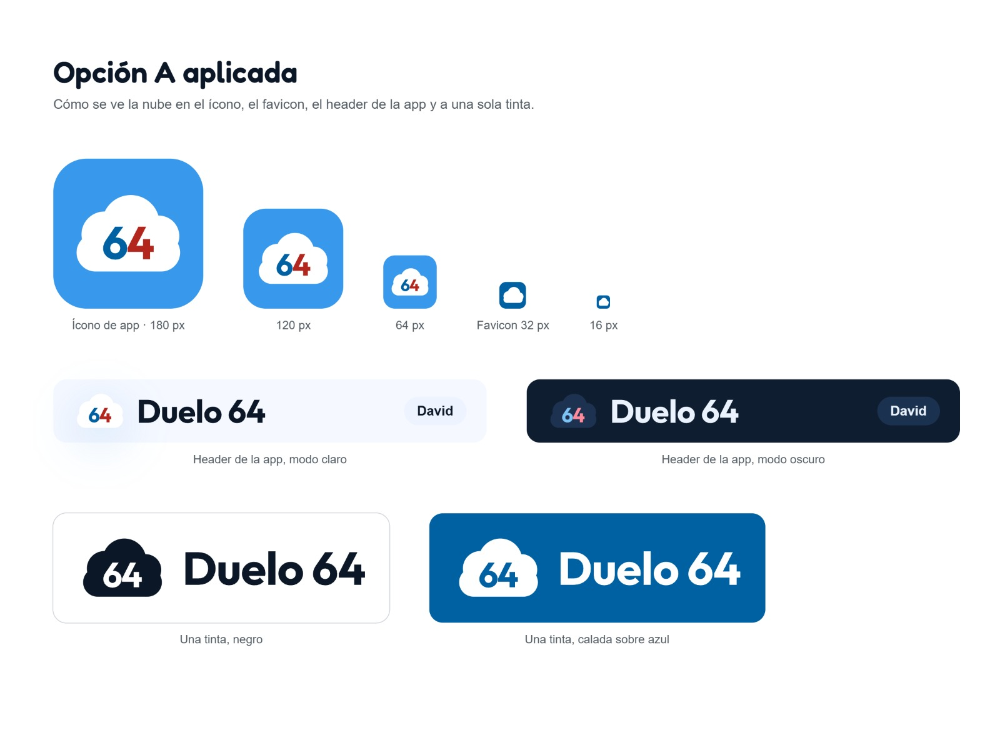

# Duelo 64 · SDD

Documentación del proyecto **Duelo 64** con Spec-Driven Development.
Este repositorio contiene solo los documentos. El código está en [`sgabrielaca25-pixel/nextjs-dashboard`](https://github.com/sgabrielaca25-pixel/nextjs-dashboard) y el juego se publica en https://juegoduelo64.vercel.app



## Por dónde empezar
1. **[docs/SDD.md](docs/SDD.md)**: documento maestro (resumen, reglas, requerimientos, arquitectura, datos, seguridad, riesgos).
2. **[docs/specs/](docs/specs/)**: una spec por funcionalidad, con criterios de aceptación.
3. **[docs/diseno/referencias/00-mapa-de-pantallas.png](docs/diseno/referencias/00-mapa-de-pantallas.png)**: cómo se ve cada pantalla.

## Estructura
```
duelo64-sdd/
├── CLAUDE.md                     reglas para el agente
├── BITACORA_IA.md                prompts, errores y correcciones
├── .claude/skills/ui-componentes/SKILL.md
├── scripts/                      capturas-referencia.ts (Playwright)
└── docs/
    ├── SDD.md                    documento maestro
    ├── producto.md               problema, usuario, alcance
    ├── decisiones.md             por qué se hizo cada cosa
    ├── specs/                    spec001 … spec006
    ├── infraestructura/          arquitectura y despliegue
    ├── diseno/                   identidad, logo y 38 referencias
    ├── sprints/tareas.md         tareas del front
    ├── templates/                plantillas de spec y decisión
    └── evidencias/               capturas del taller
```

## Specs
| Spec | Funcionalidad |
|---|---|
| [001](docs/specs/spec001-cuentas.md) | Cuentas |
| [002](docs/specs/spec002-encontrar-rival.md) | Encontrar rival |
| [003](docs/specs/spec003-partida-en-linea.md) | Partida en línea |
| [004](docs/specs/spec004-fin-y-revancha.md) | Fin de partida y revancha |
| [005](docs/specs/spec005-perfil-estadisticas.md) | Perfil y estadísticas |
| [006](docs/specs/spec006-historial-partidas.md) | Historial de partidas (en el perfil) |

## Regla de oro
Si algo cambia, primero se actualiza el documento y después el código.
